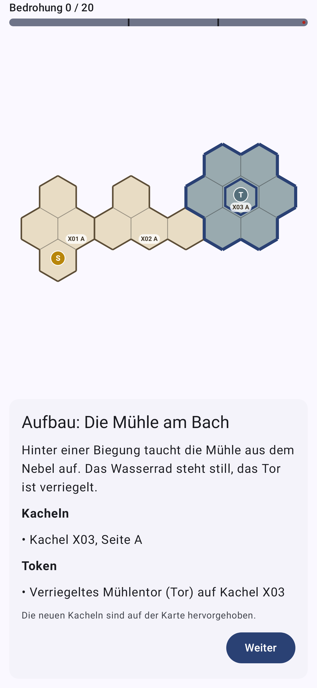
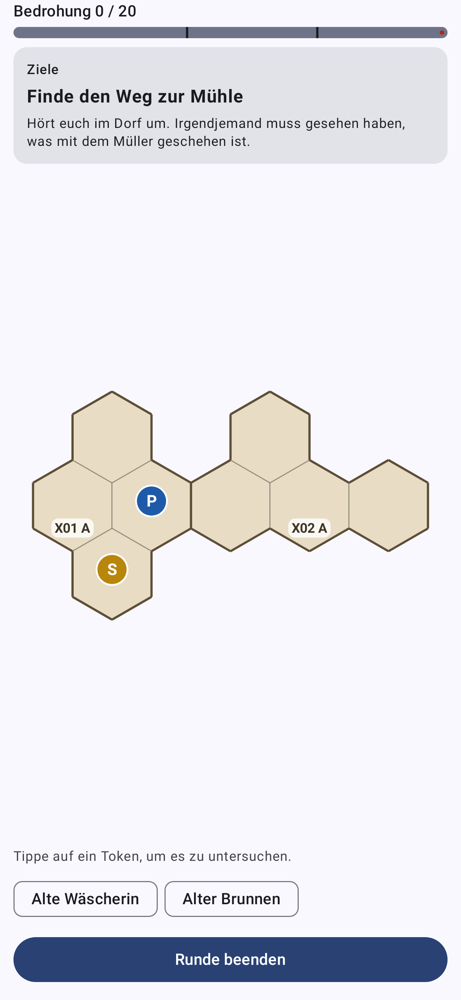
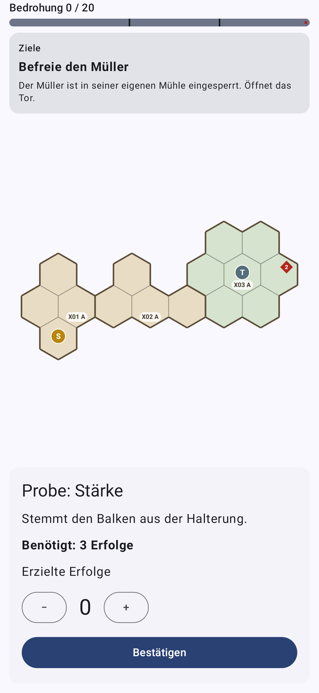
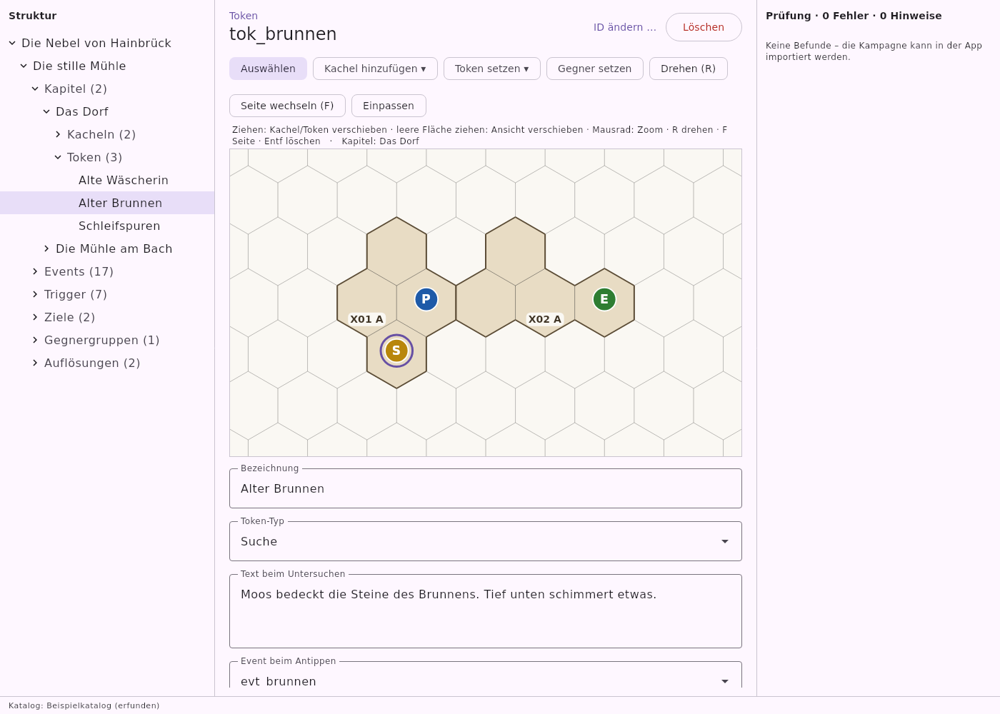
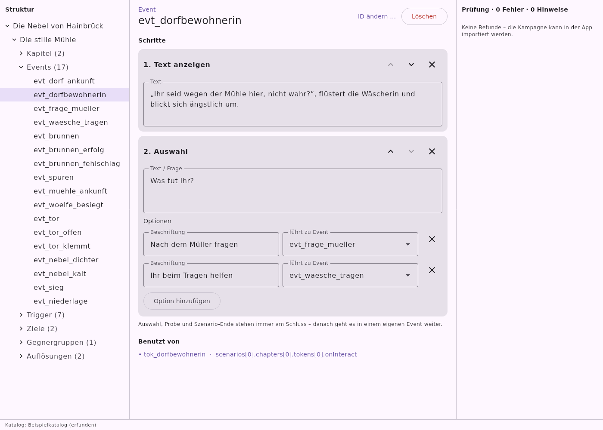
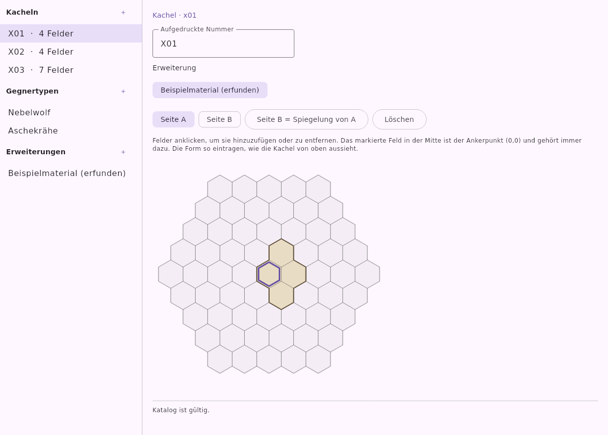
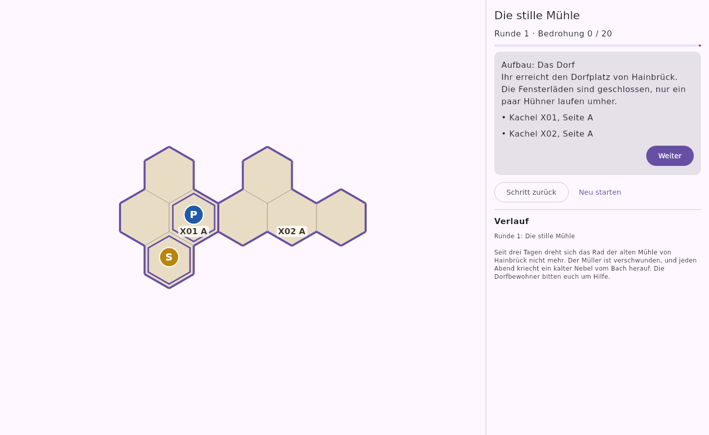

# Mittelerde Worldbuilder

Private Companion-App (Android) zum Erstellen und Spielen eigener Kampagnen für
„Der Herr der Ringe: Reise durch Mittelerde“. Enthält **keine** Inhalte von
Fantasy Flight Games – Kacheln werden schematisch dargestellt, Material wird in
einer eigenen Katalog-Datei gepflegt.

- Projektbeschreibung: [`docs/PROJEKT.md`](docs/PROJEKT.md)
- Format-Entwurf: [`docs/ENTWURF.md`](docs/ENTWURF.md)

## Module

| Modul         | Inhalt                                             |
|---------------|----------------------------------------------------|
| `:model`      | Kampagnenformat, Material-Katalog, Hex-Mathematik  |
| `:validation` | Validator mit strukturierter Fehlerliste           |
| `:engine`     | Spiellogik ohne Android-Abhängigkeit               |
| `:editing`    | Bearbeitungslogik (Umbenennen mit Verweisen, Kacheln, Katalog, Undo) |
| `:editor`     | Windows-Editor (Compose Desktop)                   |
| `:app`        | Android-App / Player (Jetpack Compose, Material 3) |

`shared/hexmap` enthält den Kartencode, den App und Editor gemeinsam einbinden.

## Stand (Phase 1)

- Kampagnenformat + JSON-Schema (`schema/`), Beispielkatalog und Beispielkampagne (`examples/`, frei erfunden)
- Validator mit strukturierter Fehlerliste (Ort, Code, Text)
- Engine: Kapitel, Token, Events, Proben, Auswahl, Trigger, Bedrohung, Ziele, Gegnergruppen, Auflösungen, Kampagnenübergänge
- App: Kampagne/Katalog importieren (mit Prüfbericht), neues Spiel, schematische Hex-Karte, Aufbau-Anweisungen, Rundenablauf, Ereignisprotokoll; Spielstände werden nach jeder Aktion automatisch gespeichert

| Aufbau | Spiel | Probe |
|---|---|---|
|  |  |  |

## Windows-Editor (Phase 2)

Kampagnen und Material-Katalog werden am PC erstellt, gespielt wird mit der Android-App.
Installation und Bedienung: [`docs/EDITOR.md`](docs/EDITOR.md). Das `.msi` und die APK baut GitHub Actions bei jedem Push.

| Karteneditor | Event-Editor | Katalog | Probespiel |
|---|---|---|---|
|  |  |  |  |

Editor lokal starten: `./gradlew :editor:run` (ohne Android-SDK: `-PskipAndroid=true`).

## Eigenen Material-Katalog anlegen

Vorlage: [`examples/beispiel-material.json`](examples/beispiel-material.json), Schema: [`schema/material.schema.json`](schema/material.schema.json).
Am einfachsten im Windows-Editor (Datei → Material-Katalog bearbeiten): Felder anklicken statt Koordinaten tippen.
Import in der App über ⋮ → „Material-Katalog importieren“.

## Bauen & Testen

```bash
./gradlew test :app:assembleDebug
```

Die App-Tests rendern Screenshots nach `app/build/screenshots/`.

Voraussetzungen: JDK 17+, Android SDK mit Plattform 36 (`local.properties` mit `sdk.dir=…`).
